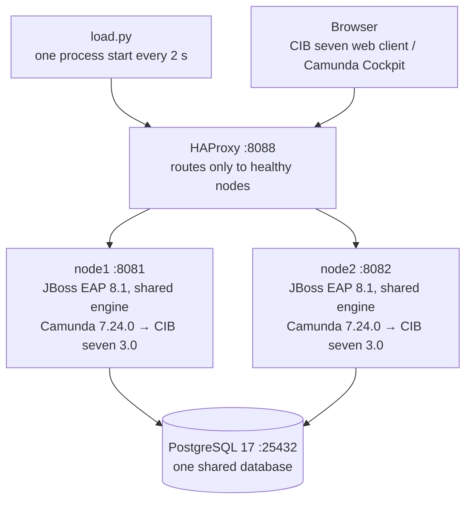
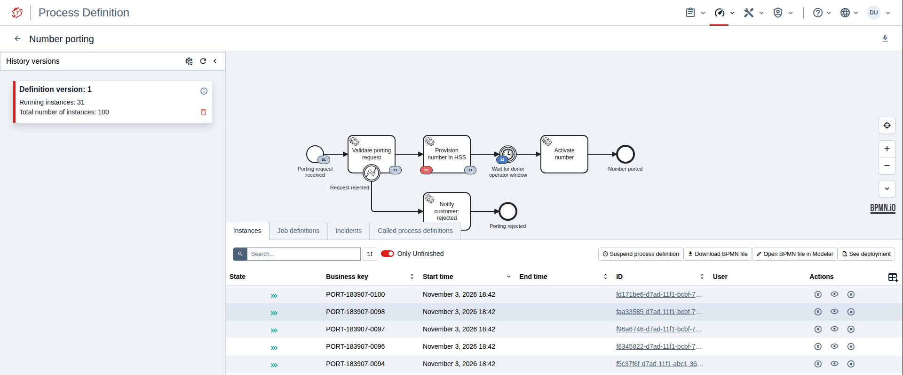
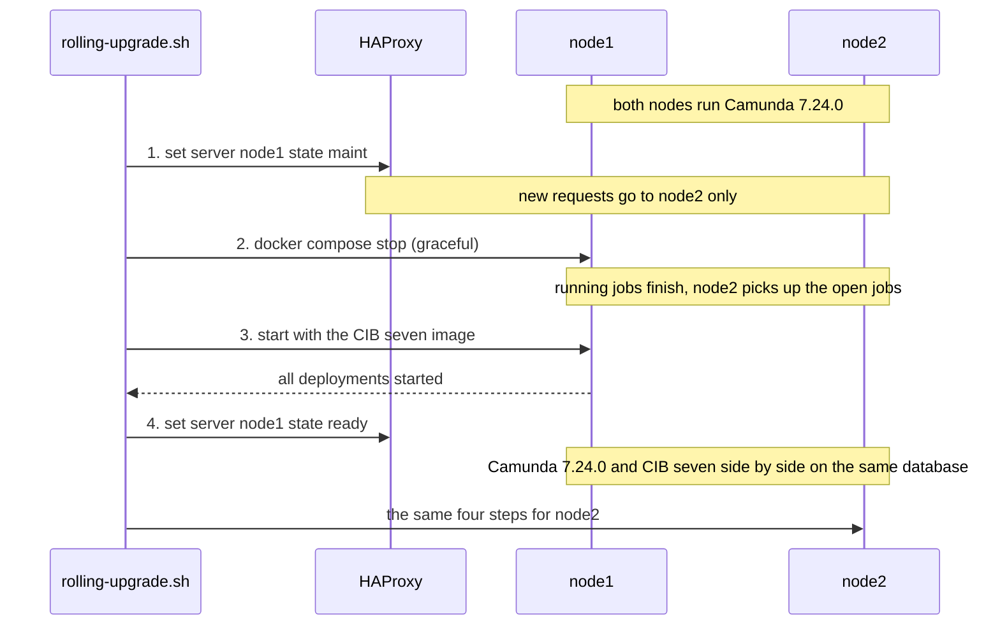
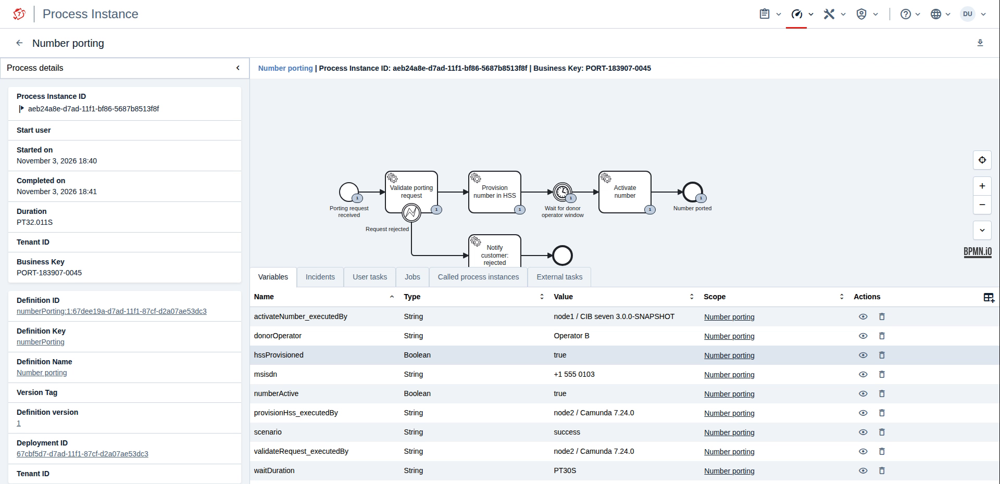

# Zero-downtime migration from Camunda 7 to CIB seven

This example moves a running two-node cluster on Red Hat® JBoss® Enterprise Application Platform (EAP) 8.1 from
**Camunda 7.24.0** to **CIB seven 3.0**, one node at a time, while process instances keep being started. No request
fails. Instances that were started on Camunda 7 finish on CIB seven.

[CIB seven](https://cibseven.org/en/) is the open-source alternative for migrating from Camunda 7. It continues the
Camunda 7 code base: the same engine, the same APIs and the same database tables. Only the Java packages and the Maven
coordinates change from `org.camunda` to `org.cibseven`.



What it shows:

- **Active-active.** Two JBoss EAP 8.1 nodes run the engine as a *shared engine* through the JBoss subsystem.
  Both nodes take API requests, both run the job executor, and both use one database.
- **A process with success and failure paths.** The `numberPorting` process models a mobile number port-in:
  - a business rejection is a BPMN error;
  - a technical failure becomes an incident with retries;
  - a timer keeps instances in flight while the cluster changes.
- **Migrating the application code.** [`app/migrate.sh`](app/migrate.sh) runs the public OpenRewrite recipe
  `org.cibseven.ReplaceCamundaWithCIBSeven` on the process application. The complete change is Maven coordinates and
  Java imports; the BPMN is untouched.
- **Rolling upgrade.** For each node, [`rolling-upgrade.sh`](rolling-upgrade.sh) runs four steps:
  1. take the node out of the load balancer;
  2. stop it gracefully;
  3. start it with the CIB seven image;
  4. put it back.

  The same script switches the cluster back to Camunda, as long as you have not
  [finished the upgrade](#5-finish-the-upgrade) (see [Roll back](#6-roll-back)).
- **Proof.** [`status.py`](status.py) lists instances whose steps ran on both engines, for example
  `validateRequest@node2 / Camunda 7.24.0 -> provisionHss@node2 / Camunda 7.24.0 -> activateNumber@node1 / CIB seven 3.0.0`.
  The CIB seven web client shows the same for every instance.

## What you need

- Linux with Docker and Compose v2, and about 10 GB of free disk space. The example was tested on Ubuntu 24.04 in
  WSL 2. The scripts need GNU bash 4 or later, GNU sed and GNU tar; on macOS, install them first (for example with
  Homebrew).
- A Red Hat account for `registry.redhat.io`, which hosts the JBoss EAP 8.1 runtime image. A free
  [Red Hat Developer subscription](https://developers.redhat.com/) is enough for development and evaluation; see
  [Licences and trademarks](#licences-and-trademarks).
- JDK 21, Maven 3.9 and Python 3.9 or later.
- Internet access for Maven Central, Red Hat's Maven repository, downloads.camunda.cloud, artifacts.cibseven.org and
  Docker Hub.

The default is CIB seven **Community Edition** from public repositories. For the **Enterprise Edition**, see
[Enterprise Edition](#enterprise-edition).

## Quick start

```bash
docker login registry.redhat.io
./build.sh                      # first run about 20 minutes (EAP provisioning), afterwards about 2 minutes
./reset.sh                      # PostgreSQL + 2x JBoss EAP with Camunda 7.24.0 + HAProxy, user demo/demo
```

Then use three terminals and a browser:

```bash
python3 load.py                 # terminal 1: one process start every 2 s through the load balancer
watch -n1 python3 status.py     # terminal 2: outcomes, incidents, which node/engine ran each step
./rolling-upgrade.sh            # terminal 3: Camunda 7.24.0 -> CIB seven, node by node
./rolling-upgrade.sh camunda    #             ... and back
```

The browser shows:

- http://localhost:8404: HAProxy, with the live status of both nodes;
- http://localhost:8081 and http://localhost:8082: the nodes directly (`/camunda` on Camunda, `/webapp` = CIB seven web client).

Log in as `demo` / `demo` on either node.

`./reset.sh` brings everything back to the start state: empty database, both nodes on Camunda. Start `load.py` only after
`reset.sh` has finished; while both nodes restart, the load balancer has nothing to route to.

## Walkthrough

### 1. The process

| Step | What happens |
|---|---|
| Validate porting request | `scenario=reject`: BPMN error, the instance ends in *Porting rejected* (business failure) |
| Provision number in HSS | `scenario=technicalFailure`: three attempts, then an incident *HSS provisioning interface timeout* (technical failure) |
| Wait for donor operator window | 30 s timer, so instances are in flight during the upgrade |
| Activate number | ends in *Number ported* (success) |

`load.py` mixes 70 % success, 15 % rejection and 15 % technical failure. To fix an incident:

1. Set the variable `scenario` to `success`.
2. Retry the incident.

The instance then continues. Every step records which node and engine ran it in a variable `<step>_executedBy`.



### 2. Migrate the application

```bash
app/migrate.sh
```

The script runs in five steps:

1. Run the tests on Camunda 7.24.0.
2. Run the recipe in a git worktree (`.migrated/`).
3. Show the diff: 8 files, only `pom.xml` and imports, no BPMN change.
4. Run the same tests on CIB seven.
5. Build `wars/camunda/number-porting.war` and `wars/cibseven/number-porting.war`. `build.sh` puts them into the
   two images.

In your own projects you run the same recipe with one Maven command:

```bash
mvn org.openrewrite.maven:rewrite-maven-plugin:run \
  -Drewrite.configLocation=https://cibseven.github.io/cibseven-migration/replace-camunda-with-cibseven.yml \
  -Drewrite.activeRecipes=org.cibseven.ReplaceCamundaWithCIBSeven
```

### 3. Rolling upgrade

`rolling-upgrade.sh` first creates the additional tables of the CIB seven web client (`MOD_*`, `CHAT_*`, `NOTIF_*`).
These tables are additive; the Camunda nodes ignore them. Then, per node:

1. `set server ... state maint` in HAProxy: new requests go to the other node.
2. `docker compose stop`: JBoss shuts down gracefully, and jobs that are not yet locked are picked up by the other node.
3. The node is started with the CIB seven image. The script waits until JBoss has started all deployments.
4. `set server ... state ready`: the node is back in the load balancer.



During the switch, Camunda 7.24.0 and CIB seven run side by side on the same database. `load.py` keeps counting
`ok=... failed=...`.

### 4. Proof

`python3 status.py` shows the instance counts per state and outcome, the open incidents, a matrix of steps per
node/engine, and the instances that ran on both engines:

```
Instances that ran on BOTH engines (started on Camunda, continued on CIB seven): 18
  PORT-160259-1681 [completed]  validateRequest@node1 / Camunda 7.24.0  ->  provisionHss@node1 / Camunda 7.24.0  ->  activateNumber@node1 / CIB seven 3.0.0-SNAPSHOT
```

The CIB seven web client shows the same in the variables of each instance. Here, `validateRequest` and `provisionHss`
ran on node2 with Camunda 7.24.0; after the timer, `activateNumber` ran on node1 with CIB seven:



### 5. Finish the upgrade

When all nodes run CIB seven and you no longer need the way back, run the engine upgrade scripts of the CIB seven
distribution once:

```bash
for s in 7.24_to_2.1 2.1_to_2.2 2.2_to_3.0; do
  docker compose exec -T db psql -q -U engine -d engine -v ON_ERROR_STOP=1 \
    < "dist/cibseven-${EDITION:-ce}/sql/upgrade/postgres_engine_$s.sql"
done
```

For the engine tables (`ACT_*`), these scripts only record the new version in `ACT_GE_SCHEMA_LOG`; `2.1_to_2.2` also
adds the table `MOD_ELEMENT_TEMPLATES`. After this step, rolling back to Camunda is no longer supported.

### 6. Roll back

```bash
./rolling-upgrade.sh camunda
```

switches the nodes back to Camunda 7.24.0 with the same four steps. This works as long as:

- the upgrade scripts of [step 5](#5-finish-the-upgrade) have not run, and
- no CIB seven node has stored Java-serialized objects that contain `org.camunda` classes again: with
  `useCibSevenNamespaceInReflection`, CIB seven may write them with `org.cibseven` class names, which Camunda cannot
  read. This example uses only String and Boolean variables.

The web client tables stay in the database; Camunda ignores them.

## How it works

### The image

Red Hat's EAP 8.1 runtime image `registry.redhat.io/jboss-eap-8/eap81-openjdk21-runtime-openshift-rhel9` contains
OpenJDK 21 and launch scripts, but no server. The build therefore assembles the server itself:

1. [`eap/pom.xml`](eap/pom.xml) provisions a plain JBoss EAP 8.1 with Red Hat's `eap-maven-plugin`, using Galleon
   with channel `org.jboss.eap.channels:eap-8.1` and feature pack `org.jboss.eap:wildfly-ee-galleon-pack`.
2. [`prepare.py`](prepare.py) takes the engine's own WildFly distribution and changes EAP's *generated*
   `standalone.xml`. It adds:
   - the engine modules (everything outside `modules/system`) and a PostgreSQL driver module;
   - the engine extension and subsystem block;
   - the datasource `java:jboss/datasources/ProcessEngine`, configured through `DB_URL`, `DB_USERNAME` and `DB_PASSWORD`;
   - for CIB seven, the web client with one JWT secret shared by both nodes.
3. The [`Dockerfile`](Dockerfile) copies the server, the modules, the configuration and the WARs into the runtime image.

The steps are the same for both engines; only the names differ:

- Camunda: `org.camunda.bpm.wildfly.camunda-wildfly-subsystem`;
- CIB seven: `org.cibseven.bpm.wildfly.cibseven-wildfly-subsystem`.

### Engine settings

| Property | Value | Why |
|---|---|---|
| `isAutoSchemaUpdate` | `false` | one pre-created schema for the whole cluster |
| `lockTimeInMillis` | `30000` | if a node dies, the other node takes over its jobs after 30 s |
| `useCibSevenNamespaceInScripting` | `true` (CIB seven) | `org.camunda.*` imports in Groovy/JavaScript scripts resolve to `org.cibseven.*` |
| `useCibSevenNamespaceInReflection` | `true` (CIB seven) | `org.camunda.*` class names in `camunda:class` and in stored serialized objects resolve to `org.cibseven.*` |
| `cronType` | `SPRING53` (CIB seven) | the same cron semantics as Camunda 7.24 while both engines run (the CIB seven default is `QUARTZ`) |

You only need the two namespace flags if you have scripts that import `org.camunda` classes, or stored Java objects
with Camunda class names; see
[Migration to CIB seven namespace](https://docs.cibseven.org/manual/latest/update/camunda/#migration-to-cib-seven-namespace).

### Why no request fails

- **HAProxy only routes to healthy nodes.** It sends requests only to nodes whose engine answers
  `GET /engine-rest/process-definition/count`, and the script puts a node into maintenance *before* stopping it.
- **Jobs don't depend on a single node.** Both nodes run the job executor. A node that stops gracefully finishes its
  current jobs; jobs it had locked when it crashed are picked up after the lock time.
- **The engine keeps no state between transactions.** Every transaction ends in the shared database, so the next step
  of an instance can run on any node; no session replication or distributed cache is needed for the engine. See the
  [clustering model](https://docs.cibseven.org/manual/latest/introduction/architecture/#clustering-model) and the
  [job executor in a cluster](https://docs.cibseven.org/manual/latest/user-guide/process-engine/the-job-executor/#cluster-setups).
- **The engine tables don't change.** Camunda 7.24 and CIB seven 3.0 use the same engine tables (`ACT_*`). The
  additional web client tables are ignored by Camunda.

### Files

| File | Purpose |
|---|---|
| [`build.sh`](build.sh) | builds the process application WARs and both images |
| [`reset.sh`](reset.sh) | starts a fresh cluster on Camunda 7.24.0 with an empty database |
| [`rolling-upgrade.sh`](rolling-upgrade.sh) | switches the nodes one by one to CIB seven, or back to Camunda |
| [`load.py`](load.py), [`status.py`](status.py) | load generator and proof |
| [`app/`](app/) | the number-porting process application and [`app/migrate.sh`](app/migrate.sh) |
| [`eap/pom.xml`](eap/pom.xml), [`prepare.py`](prepare.py), [`Dockerfile`](Dockerfile) | image build |
| [`download-camunda.sh`](download-camunda.sh), [`download-cibseven.sh`](download-cibseven.sh) | download the engine distributions |
| [`docker-compose.yml`](docker-compose.yml), [`haproxy.cfg`](haproxy.cfg) | the cluster and the load balancer |
| [`lib.sh`](lib.sh) | settings shared by all scripts |
| [`init-users.py`](init-users.py) | creates the demo user |

## Configuration

All scripts read [`lib.sh`](lib.sh). `reset.sh` writes the values to `.env` for Docker Compose and the Python
scripts. Each value can be overridden as an environment variable:

| Variable | Default | |
|---|---|---|
| `EDITION` | `ce` | `ee` for CIB seven Enterprise |
| `CIBSEVEN_VERSION` | `3.0.0-SNAPSHOT` (`3.0.0-ee-SNAPSHOT` for EE) | or a release, e.g. `2.2.0` |
| `CAMUNDA_VERSION` | `7.24.0` | |
| `IMAGE_PREFIX` | empty | e.g. `test-` for a second set of images |
| `COMPOSE_PROJECT_NAME` | `eap-rolling` | |
| `LB_PORT`, `NODE1_PORT`, `NODE2_PORT` | `8088`, `8081`, `8082` | |
| `STATS_PORT`, `ADMIN_PORT`, `DB_PORT` | `8404`, `9999`, `25432` | HAProxy stats, HAProxy runtime API (localhost only), PostgreSQL |

### Enterprise Edition

```bash
export EDITION=ee               # CIB seven EE + EE web client
./build.sh cibseven             # Maven resolves the EE artifacts with the credentials in ~/.m2/settings.xml
./reset.sh                      # mounts ~/.cibseven/cibseven-license.txt into both nodes (CIBSEVEN_LICENSE_FILE)
```

The Enterprise Edition needs access to the CIB seven Enterprise Maven repository and a licence file. For an evaluation
licence, [contact the CIB seven team](https://cibseven.org/en/contact/). More about the
[Enterprise Edition](https://cibseven.org/en/enterprise/).

## Troubleshooting

| Problem | What to do |
|---|---|
| `unauthorized` when pulling from `registry.redhat.io` | `docker login registry.redhat.io` with your Red Hat account or a registry service account |
| A node does not start | `docker compose logs node1 \| grep -E 'ERROR\|ENGINE-'` |
| `ENGINE-03056 ... extensions` on a CIB seven node | the web client tables are missing: run `./rolling-upgrade.sh` (it creates them first) or `./reset.sh` |
| `load.py` shows `failed` right after `reset.sh` | it was started while both nodes were restarting; start it after `reset.sh` has finished |
| A node stays in MAINT on the stats page | `./rolling-upgrade.sh` was interrupted; run it again, or send `set server eap_nodes/node1 state ready` to the runtime API on `ADMIN_PORT` |

## What this example is not

This is a demonstration setup, not a production blueprint:

- the passwords are fixed;
- there is no TLS;
- there is one database without high availability;
- HAProxy runs as a single container.

For Camunda 7.24, Camunda lists JBoss EAP 8.0 as supported, and EAP 8.1 only from the Enterprise patch release 7.24.11
([supported environments](https://docs.camunda.org/manual/7.24/introduction/supported-environments/)). This example
runs 7.24.0, the last Camunda 7 Community Edition release, on EAP 8.1 for demonstration only.

On OpenShift or Kubernetes the same images work with a Service instead of HAProxy and a rolling Deployment update
instead of `rolling-upgrade.sh`: a readiness probe on `/engine-rest/process-definition/count` takes the place of the
HAProxy health check, and the web client tables must exist before the first CIB seven pod starts.

## Learn more

- [CIB seven](https://cibseven.org/en/): [download](https://cibseven.org/en/download/),
  [Enterprise Edition](https://cibseven.org/en/enterprise/), [contact](https://cibseven.org/en/contact/)
- [Migration from Camunda 7](https://docs.cibseven.org/manual/latest/update/camunda/): migration script, web client,
  namespace flags
- [Rolling update](https://docs.cibseven.org/manual/latest/update/rolling-update/)
- [Install the full distribution for JBoss EAP/WildFly](https://docs.cibseven.org/manual/latest/installation/full/jboss/)
- [Web applications](https://docs.cibseven.org/manual/latest/webapps/)
- [OpenRewrite recipe](https://github.com/cibseven/cibseven-migration)
- [Release notes](https://docs.cibseven.org/manual/latest/release-notes/)
- Questions and bug reports: [CIB seven issues on GitHub](https://github.com/cibseven/cibseven/issues)

## Licences and trademarks

This repository contains only original scripts, configuration and sample code, licensed under the
[Apache License 2.0](LICENSE). It does not contain or distribute any Red Hat, Camunda or other third-party binaries.
When you run the build, it downloads the following under your own accounts and responsibility:

1. **Red Hat:** the Red Hat JBoss Enterprise Application Platform 8.1 runtime image from `registry.redhat.io` and EAP
   artifacts from the Red Hat Maven repository. Their use is governed by Red Hat's terms: the
   [Red Hat LGPL-Based EULA](https://www.redhat.com/en/about/eulas) and your Red Hat subscription or the
   [Red Hat Developer](https://developers.redhat.com/about) program terms. Developer subscriptions cover development
   use; production use, and CI or multi-user test use, require a paid Red Hat subscription.
2. **Camunda:** the Camunda 7.24.0 Community Edition distribution from `downloads.camunda.cloud`. It is licensed
   mainly under Apache 2.0 and MIT; some libraries of its web applications are under the HeroDevs NES licence. See
   Camunda's [third-party libraries](https://docs.camunda.org/manual/7.24/introduction/third-party-libraries/).
3. **CIB seven:** CIB seven artifacts from `artifacts.cibseven.org` (Community Edition: Apache 2.0; Enterprise
   Edition: your CIB seven Enterprise licence), plus the PostgreSQL JDBC driver (BSD-2-Clause) and the `postgres` and
   `haproxy` images from Docker Hub.

**The container images you build contain Red Hat and third-party software. Do not push them to public registries or
redistribute them in any other way.**

Red Hat® and JBoss® are trademarks of Red Hat, LLC, registered in the United States and other countries. Camunda is a
trademark of Camunda Services GmbH. All other trademarks are the property of their respective owners. This project is
not affiliated with, endorsed by or sponsored by Red Hat, LLC or Camunda Services GmbH; these names are used for
identification purposes only.
